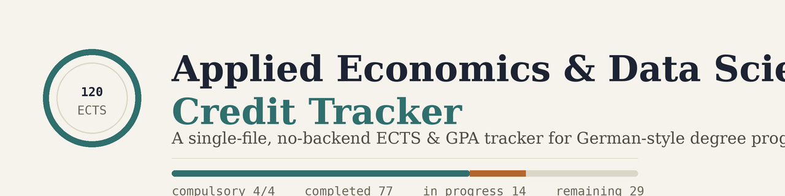

# Applied Economics & Data Science Credit Tracker

A no-backend ECTS credit and GPA tracker built for the **Applied Economics and Data Science** master's program at **Carl von Ossietzky University of Oldenburg**. Everything runs in your browser: no account, no server, no database.

---

## Why this exists

Tracking ECTS credits across five categories, dozens of elective options, German grading rules, and semester-by-semester planning in a spreadsheet gets messy fast. This tracker keeps it all in one place: what you've taken, what's left, whether you're on track to graduate, and what your GPA actually is once German grading quirks (like a 5.0 not earning credit) are accounted for.

## Features

**Interface**

- A dashboard with five views: Overview (progress ring, GPA, target GPA, semester load, countdown, alerts, per-category cards and charts), Courses (grouped by requirement), Timeline (one column per semester, drag cards to reschedule), Planner (next-semester options and the graduation path) and Checklist
- A command palette for adding courses (Ctrl/Cmd + K): search the whole catalog by code, title or lecturer, then pick the category, semester, status and grade in one step
- Sidebar navigation on desktop, a bottom tab bar with a central add button on mobile, an Appearance setting with six colour palettes (each in light and dark, all checked for WCAG AA text contrast), keyboard shortcuts (1-6 to switch views)
- Workload by semester in the Planner: credits, weekly hours and end-of-term exams per upcoming semester, with one-click suggestions to move a planned elective out of an overloaded or uneven semester (only to semesters it actually runs in)
- Print or save as PDF: an A4 progress report with the progress ring, requirements, compulsory modules, courses by semester and the suggested schedule
- A Catalog view to browse every module with search (code, title, lecturer, exam type, learning outcomes), filters (category, language, offering term, open this semester, compulsory, hide taken) and sorting by difficulty or recency
- A grade simulator in the Planner: pick an expected grade for every open course (and an average for unplanned credits) to see the projected final GPA against your target
- Touch support on phones: long-press a card to drag it, or tap it to move it to another semester, change its status, grade or category
- Undo and redo for every edit (Ctrl/Cmd + Z, Ctrl/Cmd + Shift + Z), not just removals
- Works offline once opened: a service worker caches the app and the catalog, so the installed app opens without a connection
- The previous interface is still available at `/legacy/` ("Classic view" in the footer) and reads the same saved data

**Credit tracking**

- Five categories (Economics, Empirical Methods, Data Science, Specialization, Thesis) plus an "Additional" category for extra courses that don't count toward your 120 ECTS
- Autocomplete from the program's official module catalog, with ECTS, language of instruction, workload, professor, exam type, and Stud.IP links filled in automatically
- Compulsory vs. elective labeling, with a live "compulsory courses completed" indicator
- Retake tracking (attempt 2, attempt 3), with the standard 3-attempt limit enforced

**Grades & GPA**

- German grading scale only (1.0, 1.3, 1.7 ... 4.0, 5.0), selected from a dropdown, not free text
- A 5.0 correctly excludes that course's ECTS and grade from your totals (it's a fail, not a credit)
- Overall GPA, per-category GPA, grade distribution chart, and a GPA-by-semester trend line
- "What-if" mode: add hypothetical courses and grades to preview their effect on your GPA, without touching your real record; simulated courses stay (clearly marked) after you leave the mode until you clear them, and they are kept out of the CSV export and StudIP sync

**Planning**

- A collapsible "Open this semester" panel, listing catalog courses offered this semester that you have not taken yet; its chips can be dragged straight onto their own category (or Specialization, for electives) to add them as planned courses
- The semester dropdown for a catalog course only offers the semesters that course was actually offered in on Stud.IP, so a course cannot be scheduled into a semester it does not run in
- A course detail preview in the add-course form: professor, exam type, language, offered semesters, offering-pattern hint ("Typically offered: only in WiSe"), skills, and Stud.IP link
- A graduation checklist with per-category status ticks: ✓ for categories fully completed with a grade, ◐ for categories whose ECTS gap is covered but still include planned/in-progress courses, ○ for categories genuinely short; the four compulsory courses are listed individually with the same done/planned/missing distinction
- Checklist warnings for elective courses that have not been offered recently ("last offered X, whether it will reopen is uncertain", compulsory courses are excluded from this warning, since they run every semester by definition) and "last chance this semester" alerts for compulsory courses that are open now but typically run only once a year
- A graduation path simulation in the Planner: a semester-by-semester schedule for all remaining requirements (30 ECTS/semester cap), based on when courses were actually offered, with "(likely)" markers where the usual WiSe/SoSe rhythm is assumed; it never schedules anything (including the thesis) earlier than the last semester you already have planned or in-progress courses in
- Next-semester Options A and B in the Planner: two alternative course selections for the upcoming semester specifically, starting from whatever you've already planned for it and filling the rest from what's typically offered and what you've already passed
- Drag and drop between categories and semesters, with rules that mirror how credit transfers actually work (e.g. a course moved to Specialization can only be dragged back to its original category; compulsory courses cannot be moved to Specialization)

**Course ratings**

- An anonymous, crowd-sourced course difficulty rating (1-5) shown when adding a course, alongside the average rating and vote count
- You can add, change, or remove your own rating at any time; votes are tracked per anonymous device, not per person, so re-rating a course just updates your existing vote instead of adding a duplicate
- Ratings are collected via a lightweight serverless pipeline (a GitHub Actions workflow appends each vote to a log and republishes the aggregate) and stored transparently in `ratings.json` in this repository, so anyone can inspect how the numbers are produced

**Data**

- CSV and JSON export/import for bulk operations and backups
- Automatic rolling backups (last 5 versions) of your data on every change, restorable via Data > Restore automatic backup
- QR code sharing for quick small transfers between your own devices (built from scratch, no external QR library)
- A backup reminder if you haven't exported in a while
- Course records automatically follow catalog renames (matched by module code on load), and a "New in catalog since your last visit" note appears when the daily sync picks up new modules
- A "Catalog updated" date in the footer showing when the module catalog was last synced from Stud.IP
- Everything is stored locally in your browser; nothing is sent anywhere except the optional cross-user visit counter and, if you choose to use it, the AEDS Assistant chat below

**Sync from StudIP**

- Data > Sync from StudIP walks you through copying your StuMS achievements page (log in, click "Expand all", select all and copy, no scripts required, though an optional bookmarklet can do that copy step for you) and pasting it in
- Finished modules are matched to your existing courses by their catalog module number, not by title text (StuMS truncates long titles, so a text match alone would be unreliable) and their grade is updated in place
- Modules you haven't added yet are proposed as new courses straight from the catalog (category, ECTS, professor, exam type filled in automatically); you must pick a semester (limited to the current one or earlier) before they can be added
- Nothing is sent anywhere, the pasted text is parsed entirely in your browser

**AEDS Assistant**

- A chat bubble in the bottom-right corner answers questions about the programme (admission, deadlines, courses, exam rules) using [AEDS_RAG](https://aeds-rag-assistant.ofurkan.co), a separate retrieval-augmented chatbot built for the same programme
- Anonymous by design: a guest session is created on first use and kept in your browser, with no sign-up; the conversation persists across reloads
- Full-screen on mobile, a floating panel on desktop
- Answers cite their sources: `[1]` markers open the quoted passage with a link to the document (examination regulations, programme website), and a Sources list shows every document and page used
- This is the one feature that talks to an external server, your question and the assistant's answer go to AEDS_RAG's API to be answered; nothing else in the tracker does this

## Automatic catalog updates

The module catalog lives in `catalog.csv` (one row per module: `category, code, name, ects, compulsory, source, offering, semesters_offered, language, professor, exam_type, contact_hours, studip_link, skills`) and is kept in sync with Stud.IP automatically:

- The app loads `catalog.csv` at startup and builds its module lists and course details from it, so the CSV is the single source of truth
- `scripts/fetch_catalog.py` scrapes the public AEDS course-of-study pages on Stud.IP (no login required) for every semester from WiSe 2021/22 up to the next semester and syncs the results into `catalog.csv`, including the exact semesters each module was offered in (`semesters_offered`): new modules are added, existing rows are updated, and rows with `source=studip` that appear in no scraped semester at all are removed. Deletion is skipped entirely unless at least 6 well-populated semester listings were fetched, so a partial scrape cannot wipe the catalog. The hand-maintained `compulsory` column always survives updates
- Rows whose `source` is anything other than `studip` (use `manual`) are never deleted or auto-removed; use this for modules you add by hand that the scraper does not see
- A GitHub Actions workflow (`.github/workflows/update-catalog.yml`) re-runs the scraper every morning and commits `catalog.csv` when it changed, with a changelog-style commit message (`chore: catalog update (add wir9xx; remove inf5xx; update N modules)`), so the git history doubles as a catalog changelog
- The CSV can also be edited by hand (e.g. to fix a professor name or add a module the scraper does not see); the scraper only overwrites fields it actually scraped fresh values for
- If `catalog.csv` cannot be loaded, the app falls back to the copy bundled into the build (and the classic view to its own built-in snapshot, which the workflow keeps in sync via `scripts/sync_fallback.py`)

## Tech notes

- React 18 + TypeScript, built with Vite and styled with Tailwind CSS v4; icons from lucide-react, self-hosted Fraunces, Inter and JetBrains Mono fonts
- `src/lib/` holds the framework-free logic (catalog parsing, semesters, GPA and requirement stats, planning algorithms, storage, import/export), ported one to one from the classic UI so both give the same answers
- Data stays in the same `localStorage` key and format as before, so switching between the new and the classic view loses nothing
- Tests, all run in CI before every deploy:
  - `npm test`: Vitest unit tests for the logic layer (GPA, requirements, planning, import/export, StudIP parsing, assistant context, palettes including a WCAG contrast check) plus React Testing Library tests that drive the whole app in happy-dom
  - `npm run test:e2e`: Playwright end-to-end tests against the production build on desktop and a mobile device profile (drag and drop, touch long-press drag, offline mode, QR share, every palette); third-party services are mocked, and the fixture transcript in `e2e/fixtures/` is synthetic
- Development: `npm install`, `npm run dev`; production build: `npm run build` (output in `dist/`, deployed to GitHub Pages by `.github/workflows/deploy-pages.yml`)
- The QR code encoder is a from-scratch implementation of the relevant parts of ISO/IEC 18004 (versions 1-10, error correction level L), validated by round-tripping through an independent decoder

## License

MIT. See [`LICENSE`](./LICENSE).

## Disclaimer

Not affiliated with or endorsed by Carl von Ossietzky University of Oldenburg. Built by a student, for students.
